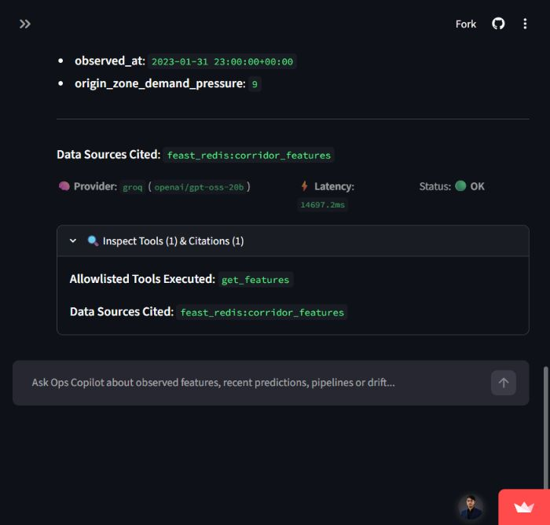
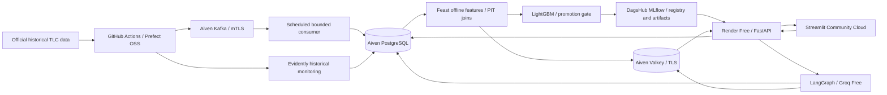

# Logistics Demand & ETA Forecasting Platform

[](https://github.com/KhuzaimaHassan/logistics-forecasting-platform/actions/workflows/ci.yml)
[](pyproject.toml)
[](pyproject.toml)

An end-to-end MLOps portfolio platform for NYC taxi pickup demand and corridor travel duration. Genuine Kafka processing, persistent PostgreSQL storage, Feast features, LightGBM models, MLflow experiments, monitoring and a LangGraph operations agent power a public dashboard and inference API.

**[Open the dashboard](https://logistics-forecasting-platform.streamlit.app/) · [Explore the API](https://logistics-forecasting-platform.onrender.com/docs) · [Deployment evidence](docs/DEPLOYMENT_REPORT.md)**

The public deployment runs on Free service plans. It processes a bounded **January 2023 Green TLC sample**, with scheduled workers and predictions computed on request. Results describe that historical sample; they are not current NYC traffic or full-city demand estimates. Render can sleep between visits: allow a few minutes for startup and retry if the dashboard initially reports the API unavailable.

## Try the deployed application

| Dashboard tab | What you can inspect |
|---|---|
| Ops Copilot | Recent pipeline runs, stored drift reports, zone 74 features or corridor 75→237 features, with provider, tool and source citations |
| Forecasts & Map | Trained-model demand for observed zones such as 74, 75 and 166, geographic positions, and ETA for 75→237 |
| Pipeline Observability | Durable run history, processed/rejected counts and the historical sample checkpoint |
| Model Monitoring | Data drift, prediction drift, performance alerts and persisted interactive Evidently reports |



These examples were exercised through the public UI on **October 22, 2026**. Demand results were 3.69 / 5.55 / 2.26 for zones 74 / 75 / 166, and corridor 75→237 ETA was 715.8 seconds. These are dated observations, not fixed expected responses. See the [browser acceptance matrix](docs/STREAMLIT_ACCEPTANCE_2026-10-22.md) for screenshots, failures and verification limits.

## Deployed architecture



| Component | Public Free-cloud profile | Full local reference stack |
|---|---|---|
| Kafka-compatible streaming | Aiven Kafka, scheduled producers/consumers | Redpanda and stream workers |
| Durable storage | Aiven PostgreSQL 18.6, dedicated `logistics` database | PostgreSQL 16 |
| Online features/cache | Feast with TLS Valkey | Feast with Redis 7 |
| Experiments/models | DagsHub MLflow tracking, artifacts and registry | MLflow server |
| Orchestration | Prefect OSS flows executed by GitHub Actions | Prefect flows and configurable workers |
| Inference | FastAPI on Render Free, native LightGBM loading | FastAPI container |
| Dashboard | Streamlit Community Cloud | Streamlit container behind Caddy |
| Operations agent | LangGraph with real Groq calls and read-only tools | Configurable providers and retrieval |
| Monitoring | Scheduled Evidently backtests, PostgreSQL JSON/HTML | Evidently analyzers and retraining hooks |

The original Compose stack, full ETL, feed clients, training and monitoring remain in the repository. They are not all continuously hosted in the Free profile. See [Architecture](docs/Architecture.md) and the [ADRs](docs/Decisions.md) for reference designs and deployment-specific decisions.

## Engineering highlights

- **Real event processing:** Kafka acknowledgments, durable consumer offsets, validation and dead-letter routing; valid events persist in PostgreSQL.
- **Feature consistency:** Feast point-in-time historical retrieval and online materialization, aligned categorical domains, official polygon-derived zone centroids and explicit observation timestamps.
- **Actual model serving:** LightGBM models load from MLflow Production artifacts. Cloud mode does not substitute untrained models or synthetic predictions when dependencies fail.
- **Reproducible ML:** tracked metrics/artifacts, chronological evaluation, promotion gates and idempotent scheduled jobs. Runtime/data/model fingerprints avoid recomputation for documentation-only changes.
- **Operational transparency:** predictions and monitoring reports persist in PostgreSQL; the UI preserves real alerts and separates materialization time from the historical observation window.
- **Read-only Copilot tools:** feature lookup, prediction history, pipeline status, documentation retrieval and monitoring queries with tool/source metadata. Cloud provider failures surface explicitly instead of using a mock response.
- **Resource-aware CI/CD:** deterministic source checks without cloud secrets, separate managed-service checks, Compose smoke tests and AMD64/ARM64 builds. Cloud jobs serialize shared warehouse operations.

## Verification and current limits

The [deployment report](docs/DEPLOYMENT_REPORT.md) contains dated commands, workflow links and a service verification matrix. Recorded evidence includes genuine Kafka production/consumption, PostgreSQL persistence, Feast/Valkey retrieval, MLflow metrics/artifacts, model training, public forecasts, Groq tools and durable monitoring reports.

- A genuine `schedule`-triggered pipeline passed ([run 39482347476](https://github.com/KhuzaimaHassan/logistics-forecasting-platform/actions/runs/39482347476)); it arrived roughly four hours late. GitHub schedules are best effort. Separate training and monitoring cron execution is not certified by this pipeline result.
- The bounded source contains 10,000 sampled positions: 9,232 valid trips and 768 rejected records. Once consumed, scheduled runs do not invent new trips; they reconcile existing data and renew online feature availability.
- Idle recovery was exercised: the first forecast after a measured quiet interval took **141 seconds**. A later browser session initially exceeded a 90-second health timeout and recovered on rerun. There is no low-latency or availability guarantee on Free compute.
- A real historical **29.9% MAE decay alert** remains visible. Earlier full-population ETA benchmark claims require recertification after leakage corrections and are not advertised as deployed model quality.
- **PostgreSQL memory investigation remains open.** Aiven reported an OOM interruption on October 21. Database size was about 67 MiB in the latest recorded snapshot, but that does not establish memory stability or the OOM cause. See the [memory runbook](docs/POSTGRES_MEMORY_RUNBOOK.md). No data was deleted or paid upgrade enabled.
- Embedded monitoring HTML is verified; saved-download completion is not independently verified. Documentation retrieval returned citations but answer relevance was limited; hosted FAISS execution and complete multi-entity agent planning are not certified.

**Expected recurring hosting cost: $0/month within Free quotas.** The owner confirmed removal of the Render payment card and no Groq payment method. Account billing controls were owner-confirmed, not independently audited. Sleeping, rate limits, quota exhaustion and suspension remain possible; this is a portfolio deployment without an uptime SLA. Review [provider research](docs/FREE_TIER_RESEARCH.md) and [setup instructions](docs/FREE_CLOUD_SETUP.md) before provisioning your own instance.

## API examples

The public [OpenAPI documentation](https://logistics-forecasting-platform.onrender.com/docs) is the contract reference. These requests perform real inference; run them sparingly on Free infrastructure.

```bash
# Readiness includes dependencies and models; may return 503 during startup.
curl --max-time 180 https://logistics-forecasting-platform.onrender.com/health/ready

# Demand for an observed zone.
curl --max-time 180 https://logistics-forecasting-platform.onrender.com/predict/demand/74

# ETA between observed pickup and dropoff zones.
curl --max-time 180 'https://logistics-forecasting-platform.onrender.com/predict/eta?origin=75&dest=237'
```

| Method | Route | Purpose |
|---|---|---|
| GET | `/zones` | Zone metadata and observed-feature availability |
| GET | `/deployment/status` | Deployment/data provenance |
| GET | `/predict/demand/{zone_id}` | Single-zone demand |
| POST | `/predict/demand/batch` | Demand for selected zone IDs |
| GET | `/predict/eta?origin=75&dest=237` | Corridor ETA |
| POST | `/predict/eta/batch` | Batch corridor ETA |
| GET | `/features/{entity_type}/{entity_id}` | Online zone/corridor features |
| GET | `/pipeline/status` | Stored pipeline run history |
| GET | `/monitoring/reports` | Persisted monitoring summaries |
| GET | `/monitoring/reports/{report_id}/html` | Interactive report HTML |
| POST | `/agent/chat` | Copilot; shared access key required in cloud mode |
| GET | `/health/live` | Process liveness |
| GET | `/health/ready` | Dependency/model readiness |

## Local development

Use Python 3.11+, [uv](https://docs.astral.sh/uv/) and, for the full infrastructure stack, Docker Engine with Compose v2. Local Docker is optional for source work; integration containers can run in GitHub Actions.

```bash
git clone https://github.com/KhuzaimaHassan/logistics-forecasting-platform.git
cd logistics-forecasting-platform
uv sync --frozen --all-extras

# Create your own local configuration; never commit credentials.
cp .env.example .env
# Edit .env, then start the local reference stack when Docker is available.
docker compose up -d --build
docker compose ps
```

See [environment setup](docs/Environment-Setup.md) and [local deployment](docs/Deployment.md) for configuration, ingress and service initialization. Running containers alone does not bootstrap historical data, materialize features or train models. For managed Free-cloud initialization and secure secret entry, follow [FREE_CLOUD_SETUP.md](docs/FREE_CLOUD_SETUP.md). Keep certificates, tokens and private keys outside Git.

```bash
# Offline configuration validation.
uv run python scripts/validate_cloud_config.py

# Formatting/linting and the source test command used by CI.
uv run ruff check .
uv run black --check .
uv run pytest
```

PR source checks do not receive managed credentials. Container and managed-service verification have separate workflow stages; a passing unit test is not evidence of a successful cloud deployment. Dispatch managed jobs only after configuring the `free-cloud` environment and understanding their resource impact.

## Repository guide

| Path | Responsibility |
|---|---|
| `src/extract/`, `src/transform/` | TLC extraction, Kafka publishing/consumption and validation |
| `src/features/` | Feast entities, views, offline and online stores |
| `src/training/` | Baselines, model training, evaluation and promotion |
| `src/serving/` | FastAPI contracts, feature retrieval and inference |
| `src/agents/` | LangGraph provider routing, read-only tools and retrieval |
| `src/monitoring/`, `src/orchestration/` | Drift analysis and Prefect jobs |
| `ui/` | Streamlit dashboard |
| `scripts/`, `.github/workflows/` | Cloud bootstrap, bounded diagnostics, verification and CI/CD |
| `infra/`, `docker-compose.yml` | Local and deployment infrastructure |
| `tests/` | Unit, contract and integration verification |

## Documentation

| Document | Contents |
|---|---|
| [Deployment report](docs/DEPLOYMENT_REPORT.md) | Actual service status, evidence and blockers |
| [Free-cloud setup](docs/FREE_CLOUD_SETUP.md) | Provider setup, secrets, deployment and verification commands |
| [Deployment log](docs/DEPLOYMENT_LOG.md) | Incremental implementation and test results |
| [Browser acceptance](docs/STREAMLIT_ACCEPTANCE_2026-10-22.md) | Public UI matrix and screenshots |
| [Architecture](docs/Architecture.md) / [Decisions](docs/Decisions.md) | Reference topology and ADRs |
| [Database](docs/Database.md) / [Feature store](docs/Feature-Store.md) | Schemas, entities and feature design |
| [ML pipeline](docs/AI-Pipeline.md) / [Monitoring](docs/Monitoring.md) | Training, evaluation and drift design |
| [API](docs/API.md) / [Agents](docs/Agents.md) | Service and Copilot design; check live OpenAPI for current routes |
| [Security](docs/Security.md) / [Roadmap](docs/Roadmap.md) | Security boundaries and milestone history |

## License

Project metadata declares MIT in [pyproject.toml](pyproject.toml). A standalone license file has not yet been added.
