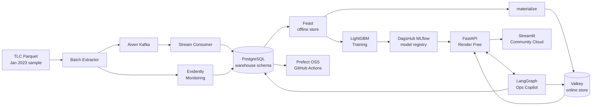
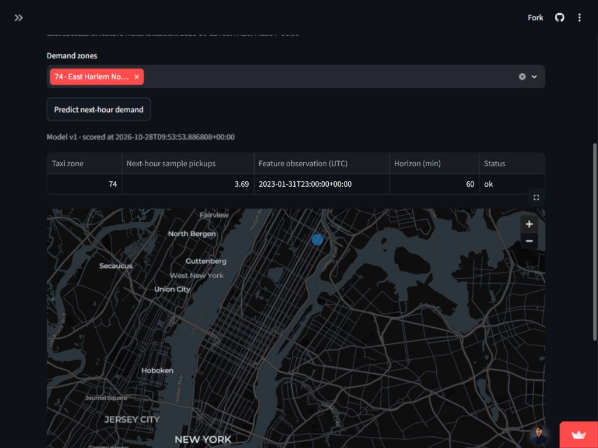
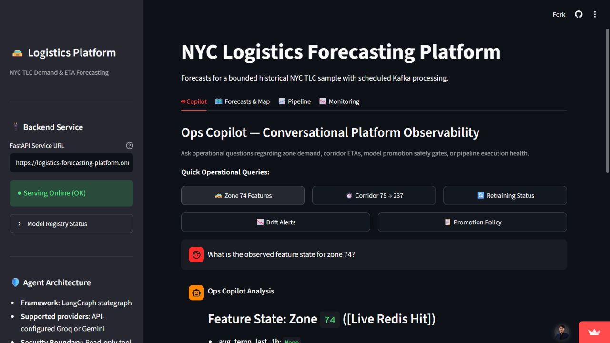
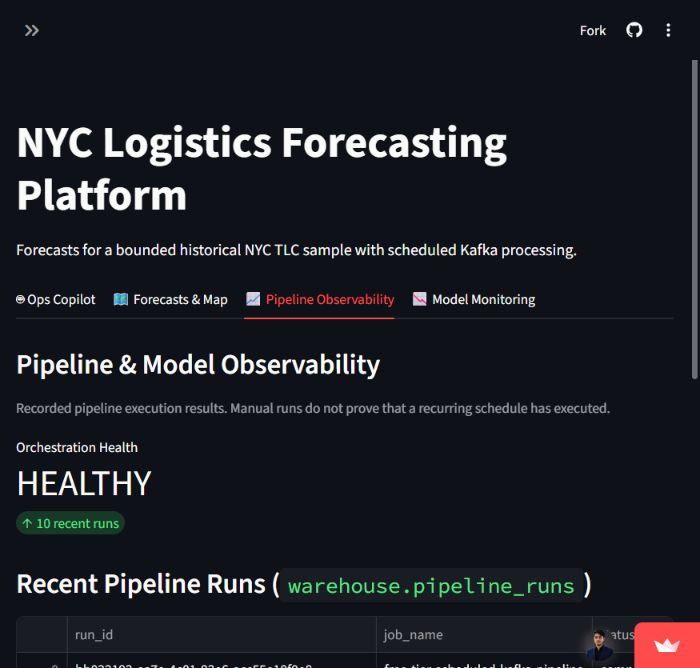
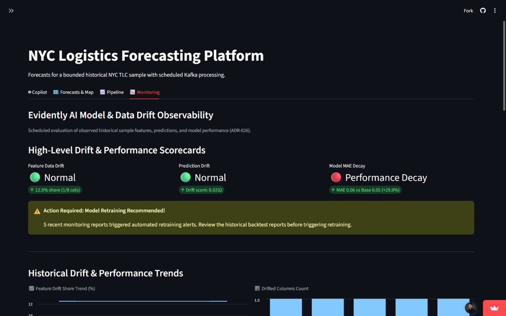

<div align="center">

# Logistics Forecasting Platform

**NYC taxi zone demand forecasting and corridor ETA prediction — end-to-end MLOps on free cloud services.**

[](https://github.com/KhuzaimaHassan/logistics-forecasting-platform/actions/workflows/ci.yml)
[](pyproject.toml)
[](pyproject.toml)
[](https://logistics-forecasting-platform.onrender.com/docs)
[](https://logistics-forecasting-platform.streamlit.app/)

[**Live Dashboard →**](https://logistics-forecasting-platform.streamlit.app/) &nbsp;·&nbsp; [**API Docs →**](https://logistics-forecasting-platform.onrender.com/docs) &nbsp;·&nbsp; [**Deployment Report →**](docs/DEPLOYMENT_REPORT.md)

</div>

> **Data scope:** forecasts are trained on a bounded January 2023 NYC Green Taxi sample (9,232 valid trips). This is not a live feed of current city traffic — it is a fully instrumented MLOps pipeline demonstrating production-grade engineering on historical data. Render Free instances may need 1–2 minutes to wake from cold start.

---

## Overview

A production-pattern MLOps platform that covers the complete lifecycle from raw trip data to served predictions:

- **Demand forecasting** — LightGBM model predicting pickup volume per taxi zone per time window
- **ETA prediction** — trip duration model for zone-to-zone corridors
- **Online feature serving** — Feast feature store backed by Valkey (Redis-compatible)
- **Ops Copilot** — LangGraph agent with Groq LLM, grounded in live pipeline state via typed tools
- **Drift monitoring** — Evidently AI reports with performance-decay alerting
- **Pipeline observability** — Prefect-orchestrated jobs with persistent run history

---

## Architecture



**Free cloud profile:** GitHub Actions triggers bounded Prefect OSS flows on a schedule. The pipeline replays the historical sample through Kafka, validates and stores trips in PostgreSQL, materializes features to Valkey, trains models, and runs Evidently drift reports. The dashboard calls the FastAPI inference endpoint on demand.

**Local Compose stack:** Redpanda · PostgreSQL 16 · Redis 7 · MLflow · Prefect · Caddy 2

See [Architecture.md](docs/Architecture.md) and [Decisions.md](docs/Decisions.md) for design rationale and ADRs.

---

## Tech Stack

| Layer | Cloud (deployed) | Local (Compose) |
|---|---|---|
| **Message bus** | Aiven Kafka | Redpanda |
| **Warehouse** | Aiven PostgreSQL 18 | PostgreSQL 16 |
| **Online store** | Aiven Valkey | Redis 7 |
| **Feature store** | Feast 0.65 | Feast |
| **Model training** | LightGBM · XGBoost | same |
| **Experiment tracking** | DagsHub MLflow | MLflow (self-hosted) |
| **Inference API** | FastAPI · Render Free | FastAPI · Uvicorn |
| **Orchestration** | Prefect OSS · GitHub Actions | Prefect |
| **Monitoring** | Evidently AI | same |
| **Agent** | LangGraph · Groq · FAISS | same |
| **Dashboard** | Streamlit Community Cloud | Streamlit |
| **Reverse proxy** | — | Caddy 2 |
| **Package manager** | uv | uv |

---

## Dashboard

Four pages, one connected workflow. Screenshots from live public app sessions (October–November 2026).

<table>
  <tr>
    <th width="50%">Forecasts & Zone Map</th>
    <th width="50%">Ops Copilot</th>
  </tr>
  <tr>
    <td><a href="docs/assets/desktop-forecast.jpg"></a><br><sub>LightGBM demand output with geographic zone context.</sub></td>
    <td><a href="docs/assets/page-copilot.jpg"></a><br><sub>Natural-language queries grounded in live feature and prediction state.</sub></td>
  </tr>
  <tr>
    <th>Pipeline Observability</th>
    <th>Model Monitoring</th>
  </tr>
  <tr>
    <td><a href="docs/assets/page-pipeline.jpg"></a><br><sub>Persistent orchestration history and ingestion checkpoints.</sub></td>
    <td><a href="docs/assets/page-monitoring.jpg"></a><br><sub>Drift scorecards, historical trends, and a genuine 29.9% MAE decay alert.</sub></td>
  </tr>
</table>

**Quick tries:**

| Page | Try this |
|---|---|
| Forecasts & Map | Zones **74, 75, 166** · ETA corridor **75 → 237** |
| Ops Copilot | *"What are the latest features for zone 74?"* |
| Pipeline Observability | Inspect the most recent scheduled run |
| Model Monitoring | Review the performance-decay alert |

---

## API

The [OpenAPI docs](https://logistics-forecasting-platform.onrender.com/docs) cover all routes. Run requests sparingly on shared Free infrastructure.

```bash
# Health — may return 503 during cold start, retry after ~2 min
curl --max-time 180 https://logistics-forecasting-platform.onrender.com/health/ready

# Demand forecast — 60-minute horizon supported in cloud profile
curl --max-time 180 'https://logistics-forecasting-platform.onrender.com/predict/demand/74?horizon_minutes=60'

# ETA prediction — zone 75 → zone 237
curl --max-time 180 'https://logistics-forecasting-platform.onrender.com/predict/eta?origin=75&dest=237'
```

---

## Local Development

Requires **Python 3.11+**, [**uv**](https://docs.astral.sh/uv/), and **Docker Engine with Compose v2** for the full stack. Source-only work does not require Docker.

```bash
git clone https://github.com/KhuzaimaHassan/logistics-forecasting-platform.git
cd logistics-forecasting-platform

uv sync --frozen --all-extras
cp .env.example .env
# Populate .env with service credentials before starting

docker compose up -d --build
```

Containers start the services but do not bootstrap data, features, or models. Follow [Environment-Setup.md](docs/Environment-Setup.md) and [Deployment.md](docs/Deployment.md) for full initialization.

<details>
<summary><strong>Linting, type checks, and tests</strong></summary>

```bash
uv run ruff check .
uv run black --check .
uv run pytest tests/ -v
uv run python scripts/validate_cloud_config.py
```

CI source checks run without managed credentials. Containers execute in separate CI stages. The `free-cloud` GitHub environment is required for managed-service integration tests.

</details>

---

## Repository Structure

```
.
├── src/
│   ├── extract/        # Batch TLC Parquet extractor and Kafka producer
│   ├── transform/      # Stream consumer, validation, cleaning, dead-letter routing
│   ├── features/       # Feast feature repo — entities, feature views, sources
│   ├── training/       # LightGBM/XGBoost pipelines, evaluation, MLflow logging
│   ├── serving/        # FastAPI — prediction, feature lookup, health endpoints
│   ├── agents/         # LangGraph Ops Copilot — Feast, MLflow, DB, FAISS tools
│   ├── monitoring/     # Evidently drift analysis and report persistence
│   └── orchestration/  # Prefect flow definitions and schedules
├── ui/                 # Streamlit app — map, monitoring dashboard, copilot chat
├── infra/
│   ├── docker-compose.yml
│   └── oracle-vm/      # Ampere A1 provisioning scripts (reference)
├── scripts/            # Bootstrap, cloud config validation, diagnostics
├── tests/              # Unit, integration, and contract tests (pytest)
├── docs/               # Architecture, ADRs, database schema, runbooks
└── .github/workflows/  # CI/CD — lint, test, managed-service checks, deploy
```

---

## Deployment Constraints

This is a Free-tier deployment. The [deployment report](docs/DEPLOYMENT_REPORT.md) documents verified evidence and unresolved limits honestly.

| Constraint | Detail |
|---|---|
| **Data scope** | 9,232 valid trips from a January 2023 Green Taxi sample. Scheduled runs reconcile stored data; no new trips are generated. |
| **Compute** | Render Free instances sleep after inactivity. Cold starts take 1–2 minutes. [750 free instance hours/month](https://render.com/docs/free#free-instance-hours) are shared across services — avoid uptime polling. |
| **Model accuracy** | A **29.9% MAE decay alert** is visible in the monitoring page. No production accuracy SLA is claimed. |
| **Cost** | Target: **\$0/month** within Free-tier quotas. No uptime SLA. Billing controls were owner-confirmed; keep paid resources disabled. |

---

## Documentation

| Topic | Link |
|---|---|
| System architecture & data flow | [Architecture.md](docs/Architecture.md) |
| Architectural decision records (ADRs) | [Decisions.md](docs/Decisions.md) |
| Database schema | [Database.md](docs/Database.md) |
| Feature store design | [Feature-Store.md](docs/Feature-Store.md) |
| Training pipeline | [AI-Pipeline.md](docs/AI-Pipeline.md) |
| API reference | [API.md](docs/API.md) |
| LangGraph Ops Copilot | [Agents.md](docs/Agents.md) |
| Monitoring & drift | [Monitoring.md](docs/Monitoring.md) |
| Free cloud setup guide | [FREE_CLOUD_SETUP.md](docs/FREE_CLOUD_SETUP.md) |
| Local environment setup | [Environment-Setup.md](docs/Environment-Setup.md) |
| Deployment log | [DEPLOYMENT_LOG.md](docs/DEPLOYMENT_LOG.md) |
| Deployment report (evidence) | [DEPLOYMENT_REPORT.md](docs/DEPLOYMENT_REPORT.md) |
| Security | [Security.md](docs/Security.md) |
| Roadmap | [Roadmap.md](docs/Roadmap.md) |

---

<sub>License: MIT (declared in <a href="pyproject.toml">pyproject.toml</a>). Author: Khuzaima Hassan.</sub>
