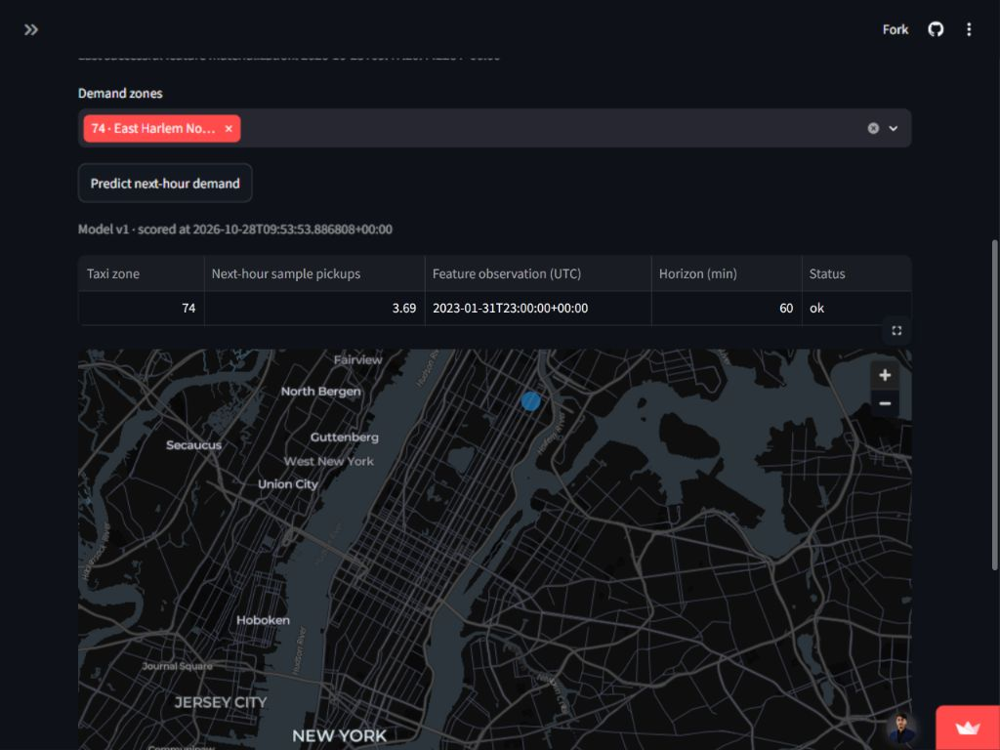
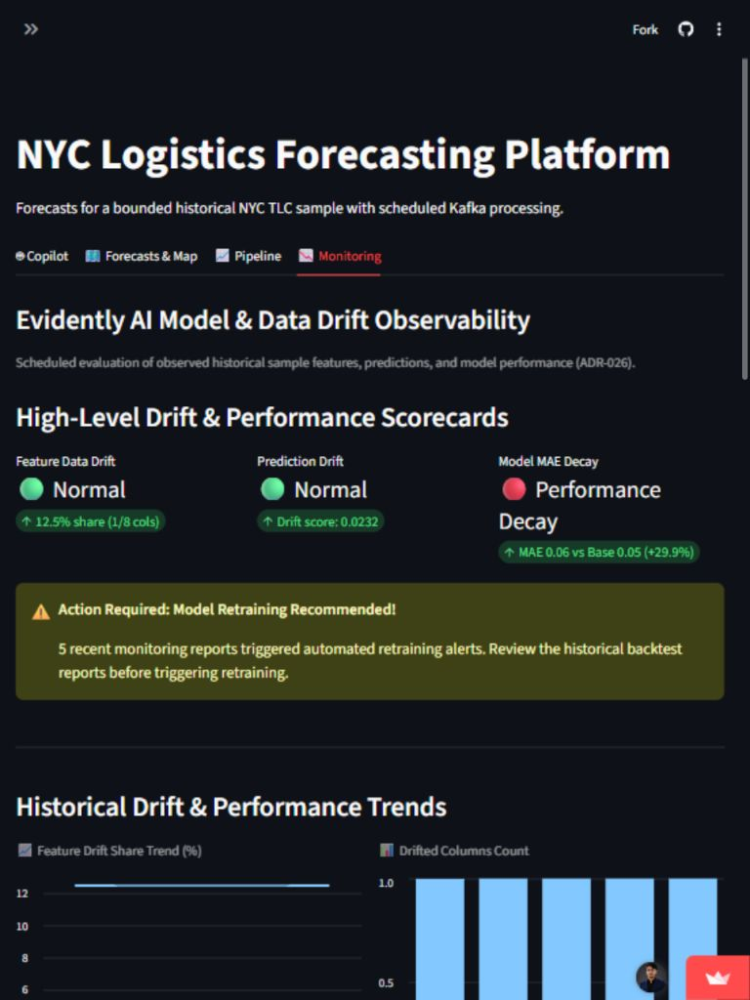
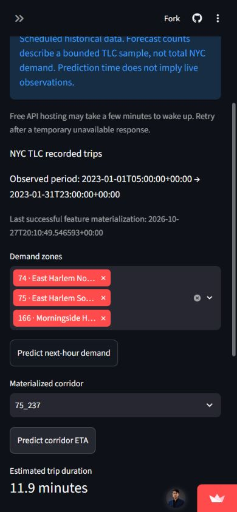
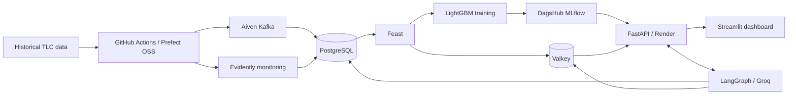

<div align="center">

# NYC Logistics Forecasting Platform

**From taxi trips to demand forecasts, corridor ETAs and operational insights.**

A public MLOps portfolio built around real event processing, online features and trained models.

[](https://github.com/KhuzaimaHassan/logistics-forecasting-platform/actions/workflows/ci.yml)
[](pyproject.toml)
[](https://logistics-forecasting-platform.onrender.com/docs)
[](https://logistics-forecasting-platform.streamlit.app/)

**[Open dashboard →](https://logistics-forecasting-platform.streamlit.app/) · [Explore API →](https://logistics-forecasting-platform.onrender.com/docs) · [Deployment evidence →](docs/DEPLOYMENT_REPORT.md)**

</div>

> **Before you try it:** forecasts describe a bounded **January 2023 Green TLC sample**, not current NYC traffic or full-city demand. Render Free can take a few minutes to wake up. Retry after startup; availability depends on shared free-tier quotas.

## See it in action

Real screenshots from the public application, captured in October 2026. Values and alerts reflect those sessions, rather than fixed expected results. Click an image to inspect it at full size.

**Desktop · demand forecast and geographic context · 1024 × 768**

[](docs/assets/desktop-forecast.jpg)

<table>
  <tr>
    <th>Tablet · model monitoring</th>
    <th>Mobile · corridor ETA</th>
  </tr>
  <tr>
    <td align="center"><a href="docs/assets/tablet-monitoring.jpg"></a></td>
    <td align="center"><a href="docs/assets/mobile-eta.jpg"></a></td>
  </tr>
  <tr>
    <td align="center">768 × 1024 · drift, alerts and trends</td>
    <td align="center">390 × 843 · controls and inference result</td>
  </tr>
</table>

## Explore the platform

| Experience | What it does | Try this |
|---|---|---|
| **Forecasts & Map** | LightGBM demand predictions, zone locations and corridor travel duration | Zones **74, 75, 166**; ETA **75 → 237** |
| **Ops Copilot** | LangGraph with Groq and read-only tools for features, predictions, pipeline history and monitoring | Ask for **zone 74 features**; inspect tool and source metadata |
| **Pipeline Observability** | Persistent job history, processed/rejected counts and ingestion checkpoints | Inspect the latest scheduled run |
| **Model Monitoring** | Evidently drift reports, performance alerts and historical trends | Review the genuine performance-decay alert |

## How the pieces connect



Kafka producers and consumers run as **bounded scheduled jobs**; PostgreSQL persists validated trips, predictions and reports. Feast serves online features from Valkey, while MLflow stores experiments and model artifacts. The dashboard calls the inference API on demand.

**Public hosting:** Aiven Kafka, PostgreSQL 18.6 and Valkey · DagsHub MLflow · GitHub Actions with Prefect OSS · Render Free · Streamlit Community Cloud · Groq Free.

The full local Compose stack retains **Redpanda, PostgreSQL 16, Redis 7, MLflow, Prefect and Caddy**. See [Architecture](docs/Architecture.md) and [ADRs](docs/Decisions.md) for the reference design and cloud adaptations.

## Engineering behind the demo

- **Durable data flow:** acknowledged Kafka writes, consumer offsets, validation and dead-letter routing, with real PostgreSQL persistence.
- **Consistent features and models:** Feast point-in-time joins, aligned categorical domains, official polygon-derived centroids and MLflow Production artifacts. Cloud inference fails explicitly when dependencies are unavailable.
- **Traceable operations:** stored predictions and reports, observation timestamps, chronological evaluation and promotion gates. Copilot responses expose tool/source metadata.
- **Resource-aware delivery:** idempotent jobs, bounded queries, serialized warehouse work, deterministic source checks, separate managed-service tests, Compose verification and AMD64/ARM64 builds.

## Deployment reality

The [deployment report](docs/DEPLOYMENT_REPORT.md) records service verification, workflow links and unresolved limits. Evidence includes Kafka production/consumption, PostgreSQL persistence, Feast retrieval, MLflow metrics/artifacts, trained-model inference and public UI interactions.

| Constraint | What to expect |
|---|---|
| **Historical sample** | 10,000 sampled positions: 9,232 valid trips and 768 rejected records. Exhausted ingestion does not invent new trips; scheduled jobs reconcile data and renew features. |
| **Free compute** | Sleeping, cold starts, rate limits and quota suspension are possible. [Render's 750 free instance hours](https://render.com/docs/free#free-instance-hours) are shared per workspace; continuous uptime polling can exhaust them across services. |
| **Model quality** | A genuine **29.9% historical MAE decay alert** remains visible. No unverified production accuracy benchmark is advertised. |
| **Operational limits** | PostgreSQL memory stability remains unconfirmed after OOM alerts. GitHub schedules are best effort. Some downloads and advanced retrieval/planning paths remain unverified; consult the report. |

**Expected recurring hosting cost: $0/month within Free quotas; no uptime SLA.** Billing controls were owner-confirmed, not independently audited. Keep paid resources disabled and follow the [cloud setup guide](docs/FREE_CLOUD_SETUP.md). Avoid uptime polling that prevents free services from sleeping.

## Try the API

Run requests sparingly on shared Free infrastructure. The [live OpenAPI docs](https://logistics-forecasting-platform.onrender.com/docs) describe all routes, including batch predictions, features, reports and authenticated Copilot requests.

```bash
# Readiness may return 503 during startup.
curl --max-time 180 https://logistics-forecasting-platform.onrender.com/health/ready

# The cloud demand model supports a 60-minute horizon.
curl --max-time 180 'https://logistics-forecasting-platform.onrender.com/predict/demand/74?horizon_minutes=60'

curl --max-time 180 'https://logistics-forecasting-platform.onrender.com/predict/eta?origin=75&dest=237'
```

## Run locally

Use Python 3.11+ and [uv](https://docs.astral.sh/uv/). Docker Engine with Compose v2 is needed for the full local stack; source work does not require local Docker.

```bash
git clone https://github.com/KhuzaimaHassan/logistics-forecasting-platform.git
cd logistics-forecasting-platform
uv sync --frozen --all-extras
cp .env.example .env
# Configure .env privately before starting services.
docker compose up -d --build
```

Follow [environment setup](docs/Environment-Setup.md) and [local deployment](docs/Deployment.md) to initialize data, features and models. Containers alone do not bootstrap them. Keep certificates, tokens and private keys outside Git.

<details>
<summary><strong>Source checks and repository guide</strong></summary>

```bash
uv run python scripts/validate_cloud_config.py
uv run ruff check .
uv run black --check .
uv run pytest
```

PR source checks do not receive managed credentials. Containers run in separate CI stages; managed checks require the configured `free-cloud` environment. Passing source tests does not establish cloud integration success.

| Path | Responsibility |
|---|---|
| `src/extract/`, `src/transform/` | Extraction, Kafka processing and validation |
| `src/features/`, `src/training/` | Feast definitions, training, evaluation and promotion |
| `src/serving/`, `src/agents/` | FastAPI inference and LangGraph tools |
| `src/monitoring/`, `src/orchestration/` | Drift analysis and Prefect jobs |
| `ui/` | Streamlit application |
| `scripts/`, `.github/workflows/` | Bootstrap, diagnostics, verification and CI/CD |
| `infra/`, `docker-compose.yml`, `tests/` | Infrastructure and automated verification |

</details>

## Read more

[Deployment report](docs/DEPLOYMENT_REPORT.md) · [Cloud setup](docs/FREE_CLOUD_SETUP.md) · [Deployment log](docs/DEPLOYMENT_LOG.md) · [Public UI audit](docs/LIVE_UI_AUDIT_2026-10-28.md)

[Architecture](docs/Architecture.md) · [Decisions](docs/Decisions.md) · [Database](docs/Database.md) · [Feature store](docs/Feature-Store.md) · [Training](docs/AI-Pipeline.md) · [Monitoring](docs/Monitoring.md)

[API](docs/API.md) · [Agents](docs/Agents.md) · [Security](docs/Security.md) · [Roadmap](docs/Roadmap.md)

<sub>License: project metadata declares MIT in <a href="pyproject.toml">pyproject.toml</a>; a standalone license file has not yet been added.</sub>
